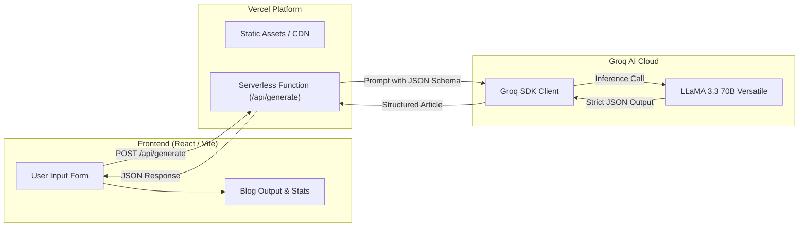

<div align="center">

# ✦ BlogForge AI ✦

### AI-Powered Blog Post Generator Powered by LLaMA 3.3 (70B) & Groq

[](https://blog-forge-ai-pi.vercel.app)
[](https://react.dev)
[](https://nodejs.org)
[](https://groq.com)
[](https://llama.meta.com)
[](LICENSE)

**Generate comprehensive, publish-ready, SEO-optimized blog posts in seconds.**

[🚀 View Live Demo](https://blog-forge-ai-pi.vercel.app) • [📖 Documentation](#table-of-contents) • [⚡ Quickstart](#quick-start)

</div>

---

## 📑 Table of Contents

- [Overview](#overview)
- [Key Features](#key-features)
- [Tech Stack](#tech-stack)
- [System Architecture](#system-architecture)
- [Project Structure](#project-structure)
- [Quick Start](#quick-start)
  - [Prerequisites](#prerequisites)
  - [1. Clone Repository](#1-clone-repository)
  - [2. Backend Setup (Local Dev)](#2-backend-setup-local-dev)
  - [3. Frontend Setup](#3-frontend-setup)
- [Environment Variables](#environment-variables)
- [API Reference](#api-reference)
- [Deployment on Vercel](#deployment-on-vercel)
- [Troubleshooting & FAQ](#troubleshooting--faq)
- [Contributing](#contributing)
- [License](#license)

---

## 🌟 Overview

**BlogForge AI** is an intelligent content generation tool that crafts structured, high-quality blog posts tailored to your chosen topic, tone, length, and SEO keywords. 

Powered by **Meta's LLaMA 3.3-70B Versatile** via **Groq's ultra-low-latency LPU inference engine**, BlogForge AI streams structured JSON responses in milliseconds, guaranteeing well-formatted articles complete with titles, structured sections, live word counts, read times, and one-click clipboard copying.

---

## ✨ Key Features

- **⚡ Lightning-Fast Inference**: Ultra-low latency responses powered by Groq's LPU engine running LLaMA 3.3-70B.
- **🎨 Configurable Tone**: Choose between *Professional*, *Casual*, *Persuasive*, and *Informative* voices.
- **📏 Target Lengths**: Select flexible word count targets (~300, ~600, or ~1000 words).
- **🎯 SEO Keyword Injection**: Naturally weave target keywords into headings and body paragraphs.
- **📊 Real-Time Content Metrics**: Dynamic calculation of total word count, estimated read time, and section count.
- **📋 One-Click Copy**: Instantly copy formatted articles to your clipboard with visual feedback.
- **☁️ Dual Mode Runtime**: Run serverless on **Vercel** (`api/generate.js`) or with **Express** locally (`server/index.js`).
- **🛡️ Robust Error Handling & JSON Parsing**: Automatic stripping of markdown fences and enforced JSON schema responses.

---

## 🛠️ Tech Stack

| Layer | Technology | Description |
| :--- | :--- | :--- |
| **Frontend** | [React 18](https://react.dev), [Vite](https://vitejs.dev) | High-performance SPA with modern component state |
| **Styling** | Vanilla CSS3 | Custom responsive dark/glassmorphic interface |
| **Serverless Backend** | [Vercel Functions](https://vercel.com/docs/functions) | Production serverless API route (`/api/generate`) |
| **Local Backend** | [Express](https://expressjs.com), [Node.js](https://nodejs.org) | Local proxy & development server |
| **AI / LLM Engine** | [Groq Cloud SDK](https://console.groq.com) | `llama-3.3-70b-versatile` with JSON Mode |
| **Deployment** | [Vercel](https://vercel.com) | Edge-optimized static client + Serverless API |

---

## 🏗️ System Architecture



---

## 📂 Project Structure

```
BlogForge_AI/
├── api/
│   ├── generate.js          # Vercel Serverless Function (Production API)
│   └── package.json         # API dependencies definition
├── client/
│   ├── public/              # Static public assets
│   ├── src/
│   │   ├── components/
│   │   │   ├── Navbar.jsx       # Header & navigation
│   │   │   ├── GenerateForm.jsx # Input form (topic, tone, words, keywords)
│   │   │   └── BlogOutput.jsx   # Article renderer with stats & copy button
│   │   ├── App.jsx          # Main application container & API caller
│   │   ├── App.css          # Core design system & theme
│   │   └── main.jsx         # React DOM entry point
│   ├── index.html           # HTML template
│   ├── postcss.config.js    # PostCSS configuration
│   ├── vite.config.js       # Vite build config & dev proxy (/api -> :5001)
│   └── package.json         # Client dependencies & scripts
├── server/
│   ├── routes/
│   │   └── generate.js      # Express route handler for local dev
│   ├── index.js             # Express app entry point (port 5001)
│   ├── .env.example         # Template for backend environment variables
│   └── package.json         # Server dependencies & scripts
├── .github/
│   └── workflows/
│       └── deploy.yml       # GitHub Actions CI build check
├── vercel.json              # Vercel deployment, rewrites & function duration
├── package.json             # Root monorepo scripts & dependencies
└── README.md                # Project documentation
```

---

## ⚡ Quick Start

### Prerequisites

- [Node.js](https://nodejs.org/) (version 18.x or 20.x recommended)
- [npm](https://www.npmjs.com/) (version 9.x or higher)
- A free [Groq Cloud API Key](https://console.groq.com/keys)

---

### 1. Clone Repository

```bash
git clone https://github.com/Kkt04/BlogForge_AI.git
cd BlogForge_AI
```

### 2. Backend Setup (Local Dev)

```bash
cd server
npm install
cp .env.example .env
```

Open `server/.env` and insert your Groq API key:

```env
GROQ_API_KEY=gsk_your_actual_groq_api_key_here
PORT=5001
```

Start the Express development server:

```bash
npm run dev
```

The backend server will run on `http://localhost:5001`.

### 3. Frontend Setup

In a new terminal window:

```bash
cd client
npm install
npm run dev
```

The Vite dev server will start at `http://localhost:3000`.

> **Note:** The Vite development server automatically proxies `/api/*` requests to `http://localhost:5001`, so no additional URL configuration is needed during local development.

---

## 🔐 Environment Variables

| Variable | Environment | Required | Description |
| :--- | :--- | :---: | :--- |
| `GROQ_API_KEY` | Vercel & Local Server | **Yes** | Your API key from [Groq Console](https://console.groq.com/keys) |
| `PORT` | Local Server (`server/`) | No | Express server port (default: `5001`) |
| `VITE_API_URL` | Client (Optional) | No | Optional API base URL override (blank in production) |

---

## 📡 API Reference

### `POST /api/generate`

Generates a structured blog post based on the supplied parameters.

#### Request Headers
```http
Content-Type: application/json
```

#### Request Body
```json
{
  "topic": "The Future of Artificial Intelligence in Healthcare",
  "tone": "Professional",
  "wordCount": "~600 words",
  "keywords": "diagnostics, machine learning, patient care"
}
```

#### Parameter Details

| Field | Type | Required | Default | Allowed Values |
| :--- | :--- | :---: | :--- | :--- |
| `topic` | `string` | **Yes** | — | Any descriptive blog topic |
| `tone` | `string` | No | `"Professional"` | `Professional`, `Casual`, `Persuasive`, `Informative` |
| `wordCount` | `string` | No | `"~600 words"` | `~300 words`, `~600 words`, `~1000 words` |
| `keywords` | `string` | No | `""` | Comma-separated SEO keywords |

#### Success Response (`200 OK`)
```json
{
  "title": "Revolutionizing Patient Care: The Future of AI in Healthcare",
  "sections": [
    {
      "heading": "Introduction to Healthcare Transformation",
      "content": "Artificial intelligence is no longer a futuristic concept..."
    },
    {
      "heading": "Accelerating Diagnostics with Machine Learning",
      "content": "Early and accurate diagnosis is critical..."
    },
    {
      "heading": "Enhancing Patient Care and Workflow Efficiency",
      "content": "Beyond diagnosis, AI tools are streamlining routine operations..."
    },
    {
      "heading": "The Horizon Ahead",
      "content": "As regulations and ethical standards continue to evolve..."
    }
  ]
}
```

#### Error Response (`400` / `500`)
```json
{
  "error": "GROQ_API_KEY environment variable is missing or empty. Please add GROQ_API_KEY to your Vercel project environment variables."
}
```

---

## 🚀 Deployment on Vercel

BlogForge AI is preconfigured for zero-friction deployment on [Vercel](https://vercel.com).

### Step-by-Step Deployment:

1. **Push your code to GitHub**:
   Ensure your changes are pushed to your GitHub repository.

2. **Import Project to Vercel**:
   - Go to [Vercel Dashboard](https://vercel.com/dashboard).
   - Click **Add New...** → **Project**.
   - Select your `BlogForge_AI` repository.

3. **Configure Environment Variables**:
   - Under **Environment Variables**, add:
     - **Key**: `GROQ_API_KEY`
     - **Value**: `gsk_your_groq_api_key`
     - **Target**: Production, Preview, Development

4. **Verify Build Settings**:
   Vercel reads `vercel.json` automatically:
   - **Framework Preset**: Vite
   - **Install Command**: `npm install && cd client && npm install`
   - **Build Command**: `cd client && npm run build`
   - **Output Directory**: `client/dist`

5. **Deploy**:
   Click **Deploy**. Your app will be live with a production URL like `https://blog-forge-ai-pi.vercel.app`!

---

## ❓ Troubleshooting & FAQ

<details>
<summary><strong>Q: Why does the app say "Something went wrong. Please try again"?</strong></summary>

Common reasons and how they are resolved:
1. **Missing `GROQ_API_KEY` in Vercel**: Navigate to Vercel Dashboard → Your Project → **Settings** → **Environment Variables**, add `GROQ_API_KEY`, and trigger a redeployment.
2. **Function Execution Timeout**: Generating 1,000 words can take 10–15 seconds. `vercel.json` includes `"maxDuration": 60` to prevent early termination.
3. **Invalid Model Identifier**: Ensure the model is set to `llama-3.3-70b-versatile` (valid Groq model).
4. **Invalid JSON formatting**: The updated `api/generate.js` enforces `response_format: { type: 'json_object' }` and strips any extraneous markdown syntax automatically.
</details>

<details>
<summary><strong>Q: Can I use a different model from Groq?</strong></summary>

Yes! You can edit the `model` property in `api/generate.js` and `server/routes/generate.js` to any active Groq model (e.g. `llama-3.1-8b-instant`, `llama-3.3-70b-versatile`, etc.).
</details>

<details>
<summary><strong>Q: How do I test the API locally?</strong></summary>

You can test the API using cURL while the Express server is running:

```bash
curl -X POST http://localhost:5001/api/generate \
  -H "Content-Type: application/json" \
  -d '{"topic": "Remote Work Productivity", "tone": "Informative", "wordCount": "~300 words"}'
```
</details>

---

## 🤝 Contributing

Contributions, issues, and feature requests are welcome!
Feel free to check the [issues page](https://github.com/Kkt04/BlogForge_AI/issues).

1. Fork the Project
2. Create your Feature Branch (`git checkout -b feature/AmazingFeature`)
3. Commit your Changes (`git commit -m 'Add some AmazingFeature'`)
4. Push to the Branch (`git push origin feature/AmazingFeature`)
5. Open a Pull Request

---

## 📄 License

This project is licensed under the [MIT License](LICENSE).
